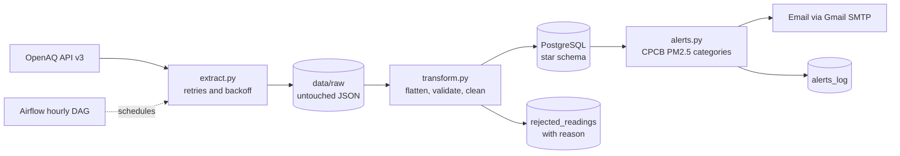

# Air Quality Pipeline and Alert System

An hourly ETL pipeline for Indian air quality data. It pulls readings from the [OpenAQ API](https://docs.openaq.org), keeps the raw responses, cleans and validates them, loads them into a PostgreSQL star schema, and emails a PM2.5 alert when a city's air stays in the "Poor" range or worse. Airflow (in Docker) runs it every hour.

## Why this project
Public air quality feeds are messy: duplicate and long-dead sensors, mixed units, physically impossible values, and providers that publish days late. This project handles those problems explicitly and records what it throws away and why.

## Architecture



Airflow runs four stages in order: `extract` → `transform_load` → `alerts`.

## What it covers
- **Stations:** 7 stations in 5 cities (Delhi, Mumbai, Chennai, Kolkata, Hyderabad), in two groups:
  - **live:** PM2.5 only, readings within about an hour. Used for alerts.
  - **full:** government monitors with many pollutants (PM2.5, PM10, NO2, O3, SO2, CO and weather). Their readings arrive late (about 2 to 5 days behind in my observations), so they feed analysis, not alerts.
- **Warehouse:** star schema in PostgreSQL: `fact_air_quality` with `dim_station`, `dim_parameter`, `dim_date`, plus `rejected_readings` and `alerts_log`.
- **Idempotent loads:** a unique key on (station, pollutant, measured time) plus `ON CONFLICT DO NOTHING`, so re-running never creates duplicates.

## Data quality rules
Every dropped row is stored in `rejected_readings` with a reason.

| Rule | Reason code | Why |
|---|---|---|
| Reading more than 7 days older than the newest reading at the same station | `stale_sensor` | Stations still carry legacy duplicate sensors with values from 2022 |
| Missing value, or negative pollutant value | `invalid_value` | Cannot be real |
| PM2.5 above 500 or PM10 above 1000 µg/m³ | `implausible_value` | Almost certainly a sensor fault (one live station reported 887 µg/m³ PM2.5) |
| Several sensors for the same station and pollutant | `duplicate_sensor` | Keep the newest, prefer µg/m³ |

On the first full run, 21 of 80 readings were rejected as stale, and one implausible 887 µg/m³ reading was caught before it could trigger a false alert. Latest figures: **TODO: add counts by reason from `rejected_readings`.**

## Alert logic
- Category limits come from the CPCB National AQI (PM2.5: Good ≤30, Satisfactory ≤60, Moderate ≤90, Poor ≤120, Very Poor ≤250, Severe above). They are defined for 24-hour averages, so categories here are applied to hourly readings and are an indication, not an official AQI.
- An email is sent only if the station is **live** (latest reading under 3 hours old), the **last 2 readings** are Poor or worse and within 3 hours of each other, and no alert was sent for that station in the last 6 hours.
- `ALERT_DRY_RUN=1` prints what would be sent without emailing.

## Tech stack
Python (requests, pandas, psycopg2), PostgreSQL 16, Apache Airflow 3.3.2, Docker Compose, pytest, Gmail SMTP.

## Run it yourself
1. Get a free API key from [explore.openaq.org](https://explore.openaq.org).
2. Copy `.env.example` to `.env` and fill in the values (API key, database credentials, optional Gmail app password).
3. Start the containers:
```
   docker compose up -d --build
```
4. Create the tables:
```
   docker cp sql/schema.sql aq_warehouse:/schema.sql
   docker exec aq_warehouse psql -U <WAREHOUSE_USER> -d <WAREHOUSE_DB> -f /schema.sql
```
5. Open http://localhost:8080. The generated login is in `/opt/airflow/simple_auth_manager_passwords.json.generated` inside the `aq_airflow` container. Unpause `air_quality_pipeline`.
6. Run the tests locally with `pytest -q` (9 tests for the AQI categories and the alert rules).

## Results
- Hourly runs completed: **TODO**
- Run success rate: **TODO**
- Readings loaded / rejected: **TODO**
- Alerts sent: **TODO**
- Typical data lag, live vs. government stations: **TODO** (from `lag_hours`)

## Limitations
- The API's "latest" endpoint returns only the newest value, so any hour the pipeline is down is missing; there is no backfill yet.
- Government monitors publish in delayed batches, so their data is always behind.
- Airflow runs in a single-container `standalone` mode with SQLite, which suits development and demos, not production.
- The pipeline only runs while Docker and the computer are on.
- Alert categories use hourly values against limits defined for 24-hour averages.

## Possible next steps
Backfill from the historical measurements endpoint, a PySpark transform, a Tableau dashboard on the warehouse, and a managed Airflow setup.